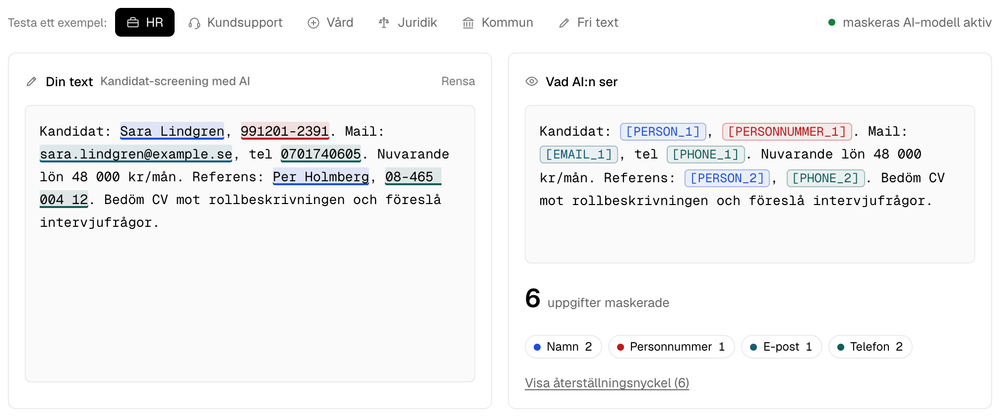
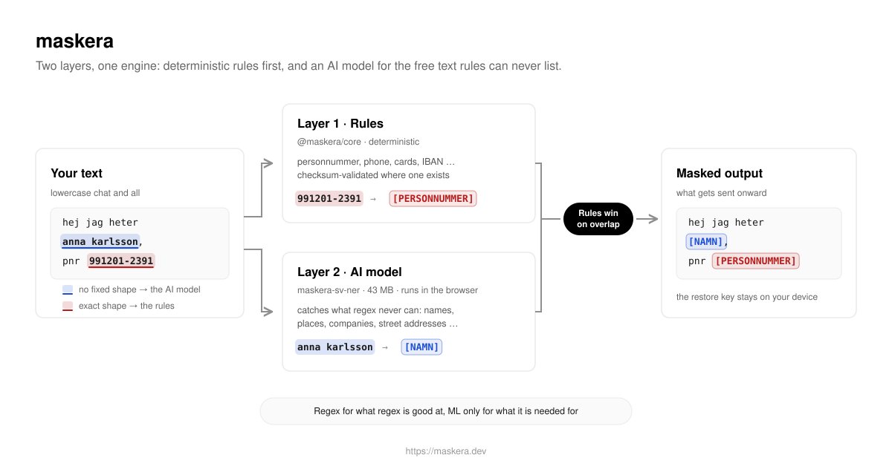

# maskera

> **Swedish PII redaction, on-device. Detected names, personnummer, and addresses are masked before your text reaches an LLM, a log, or analytics.**

<a href="https://maskera.dev"></a>

```bash
npm install maskera @huggingface/transformers   # all-in-one: rules + Swedish AI model
```

```ts
import { createNerRecognizer, redactWithNer } from "maskera"

const recognizer = createNerRecognizer() // 43 MB Swedish model, runs locally
const { text, restore } = await redactWithNer(
  "hej jag heter provnamn maskera, personnummer 19900101-2385, och bor i provbyn",
  { recognizer },
)
// text -> "hej jag heter [NAMN_1], personnummer [PERSONNUMMER_1], och bor i [PLATS_1]"
```

Masking runs locally on your device. Text and restore maps are never sent away for masking, and the packages contain no telemetry. Rules only, zero dependencies: `npm install @maskera/core`. **[Live demo: maskera.dev](https://maskera.dev)**

*(Yarn 4 PnP also needs `yarn add maskera @huggingface/transformers@4.2.0 onnxruntime-common@1.24.3`.)*

## Two ways to use it

- **Open-source npm packages (MIT):** `@maskera/core` (zero-dep deterministic rules) and `maskera` (rules + 43 MB Swedish NER model) for browser and Node.js apps.
- **Browser extension ([maskera.dev/tjanster](https://maskera.dev/tjanster) / [English](https://maskera.dev/en/services)):** masks locally inside ChatGPT, Claude, Gemini, Microsoft Copilot, Perplexity, Mistral and opt-in internal AI sites on Chrome, Edge and Firefox (Safari coming later). Free with unlimited rules + 20 AI redactions/month; Pro is SEK 149/user/month incl. VAT (7-day free trial) with unlimited AI redactions, own protected words and signed offline licences; Team is SEK 249/user/month excl. VAT (min. 5 users) and adds a shared E2EE protected-word list, MDM deployment and annual invoicing, both via [app.maskera.dev](https://app.maskera.dev).

## Two layers, rules first



1. **`@maskera/core`**: deterministic detectors for structured Swedish PII (personnummer, samordningsnummer, organisationsnummer, phone, email, postnummer, bankgiro, plusgiro, IBAN, cards, IP, URL). Zero dependencies, synchronous, extensible via `regexDetector`.
2. **`maskera`**: everything in core plus [`maskera-sv-ner`](https://huggingface.co/joelhagvall/maskera-sv-ner) (43 MB q4 ONNX, distilled from a 3-seed KB-BERT ensemble on 121,200 attested synthetic rows + 7,980 validation rows). Catches free-text names, places, organisations and street addresses, including all-lowercase chat text and ALL CAPS. Rules win on overlap.

### Use before an LLM call

```ts
const { text: safePrompt, restore } = await redactWithNer(userInput, { recognizer })
const answer = await llm(safePrompt) // OpenAI / Anthropic / Vercel AI SDK, any
const result = restore(answer)       // placeholders back to real values, locally
```

Placeholders are stable within a call so the model reasons consistently about `[NAMN_1]`. For clinical text, pass `profile: "clinical"` to retain common measurements, doses and care terms while keeping deterministic PII rules active. Runnable example: [`examples/llm-roundtrip.ts`](examples/llm-roundtrip.ts).

## Benchmarks

One canonical, dated, reproducible report: **[docs/BENCHMARKS.md](docs/BENCHMARKS.md)** (machine contract: [`docs/benchmark-release.json`](docs/benchmark-release.json)).

### Independent Swedish text (measured 2026-11-27)

Share of values hidden in Swedish text that neither Maskera nor its developer wrote: the SUC 3.0 test split (National Library of Sweden), SIC2 Swedish blogs (Språkbanken Text), the MultiCoNER v2 Swedish test split (persons) and the Swedish rows of ai4privacy openpii. Maskera v21 hid 94.6% of names (11,885/12,570). Result: [`docs/benchmark-independent-v21.json`](docs/benchmark-independent-v21.json).

| System | Names | Lowercase names | Places | Addresses + postcodes | Entity-free sentences with a hit (lower is better) |
| --- | --- | --- | --- | --- | --- |
| **Maskera v21 q4 (43 MB)** | **94.6%** | **91.1%** | **97.3%** | **95.3%** | 12.3% |
| Microsoft Presidio + sv spaCy | 72.3% | 71.4% | 97.1% | 47.0% | **2.5%** |
| swedish-pii 1.2.0 | 55.3% | 0.3% | 82.7% | 77.3% | 7.0% |
| OpenAI Privacy Filter q4 | 52.2% | 10.3% | 33.5% | 63.3% | 3.5% |

Presidio's spaCy model is trained on SUC 3.0, one of the tests. Personnummer, bankgiro and IBAN have no independent Swedish corpus and are not in this table.

### Internal release gates (v21, measured 2026-11-27, author-written)

| Benchmark (v21 q4, 43 MB) | Result | Notes |
| --- | --- | --- |
| Curated release gate (149 docs / 205 entities) | **98.8% span F1**, **0/205 leaks** | Exact span, synthetic (98.8% labeled F1) |
| Revised synthetic ADR (41 docs / 57 entities) | **100.0% span F1**, **0/57 leaks** | 35/35 ADDRESS precision, 98.2% labeled F1 |
| LinkedIn-style (32 docs / 53 entities) | **98.1% span F1**, **0/53 leaks** | Exact span, synthetic |
| Rare decomposing surnames (294 entities) | **95.24% masked recall** (280/294) | Lowercase chat register |
| Full Swedish hybrid pipeline (258 texts / 952 PII) | **937/952 (98.4%)** full hits | Rules + v21 NER across 19 domains (7 partial, 8 misses; 118 candidate junk vs 172 in v20) |
| NER vs KBLab lowermix fp32 (121 texts / 211 entities) | **210/211** orig & **211/211** lower vs 205/211 & 187/211 | 43 MB vs 496 MB; typed F1 **89.6%** vs 89.4% orig, **88.4%** vs 83.2% lower |

All v21 sets above are synthetic or author-coupled directional evidence, not an independent universal ranking. The broader dated public-model comparison belongs to historical v18 and is kept separately in [`docs/BENCHMARKS.md`](docs/BENCHMARKS.md).

## Packages & docs

| Package / doc | Purpose |
| --- | --- |
| [`@maskera/core`](packages/core) | Zero-dep detectors + redact/restore engine |
| [`maskera`](packages/ner) | Swedish NER model + hybrid pipeline (`@maskera/core` re-exported) |
| [`docs/PRODUCTION.md`](docs/PRODUCTION.md) | Self-hosting the model, thresholds, fallback and operational checklist |
| [`docs/TRANSPARENCY.md`](docs/TRANSPARENCY.md) | Privacy boundary and what runs where |
| [`docs/TRAINING_DATA_PROTECTION.md`](docs/TRAINING_DATA_PROTECTION.md) | Synthetic attestation, identifier rejection, KB-BERT boundary |
| **[maskera.dev/whitepaper.pdf](https://maskera.dev/whitepaper.pdf)** | Architecture, privacy model, measurements and GDPR positioning for DPOs/legal |

maskera is **defense in depth, not a compliance guarantee**. The rule layer is deterministic; the model catches most free-text PII but can miss edge cases.

## Development

```bash
pnpm install
pnpm demo                  # live demo at http://localhost:5180
pnpm build && pnpm test
pnpm lint                  # biome + benchmark/privacy checks
pnpm smoke                 # pack tarballs, install fresh, test ESM+CJS
pnpm eval                  # grade published model against gold corpus
pnpm eval:domain           # hybrid pipeline on 258-text synthetic domain corpus
pnpm eval:domain:clinical  # same corpus with clinical precision profile
```

Roadmap: [`docs/ROADMAP.md`](docs/ROADMAP.md).

## License

Code: MIT © [Joel Hägvall](https://joelhagvall.com). Model weights: MIT (base model KB-BERT is CC0, National Library of Sweden). See [`packages/ner/NOTICE`](packages/ner/NOTICE).

Maskera is developed and maintained by [Hägvall Labs AB](https://hagvall-labs.com) (Stockholm, Sweden, reg. no. 559598-0110).
